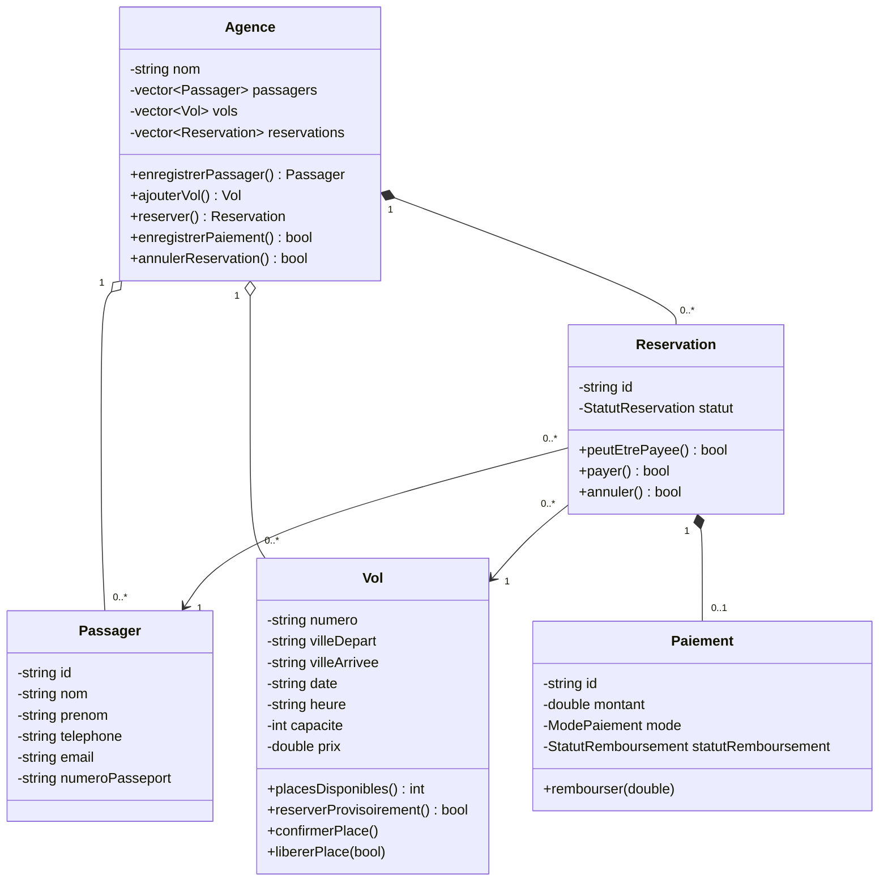

# Agence-gestion-reservation-billets-avion
projet de conception et de développement d'une application console permettant de de gérer quelques opérations
# Gestion des vols et des réservations - Agence de Cotonou

Application **console en C++17** qui informatise la gestion des vols et des réservations de billets d'avion d'une agence située à Cotonou : passagers, vols, réservations, paiements et annulations.

Projet de Programmation Orientée Objet : conception UML (PlantUML) puis implémentation C++.

## Sommaire

1. [Fonctionnalités](#fonctionnalités)
2. [Règles de gestion](#règles-de-gestion)
3. [Conception UML](#conception-uml)
4. [Structure du projet](#structure-du-projet)
5. [Compilation et exécution](#compilation-et-exécution)
6. [Captures d'exécution](#captures-dexécution)
7. [Concepts POO utilisés](#concepts-poo-utilisés)
8. [Pistes d'amélioration](#pistes-damélioration)

## Fonctionnalités

Menu principal :

| N° | Action | Description |
|---|---|---|
| 1 | Enregistrer un passager | Nom, prénom, téléphone, e-mail et passeport (contrôlés) ; identifiant `P001`, `P002`... |
| 2 | Ajouter un vol | Numéro, trajet, date, heure, capacité, prix (FCFA) ; numéro de vol unique |
| 3 | Afficher les vols disponibles | Vols qui ont encore au moins une place libre |
| 4 | Rechercher un vol | Par numéro, ville de départ, ville d'arrivée ou date |
| 5 | Effectuer une réservation | Crée une réservation `R001`... *en attente* de paiement |
| 6 | Enregistrer un paiement | Valide la réservation : la place devient définitive |
| 7 | Annuler une réservation | Libère la place ; rembourse si la réservation était payée |
| 8 | Consulter les réservations | Tableau de toutes les réservations avec un récapitulatif par statut |
| 9 | Afficher les infos d'une réservation | Détail complet : passager, vol, statut, paiement, remboursement |
| 10 | Quitter | |

## Règles de gestion

| # | Règle | Comportement dans l'application |
|---|---|---|
| 1 | Un passager doit être enregistré avant de réserver | Réservation refusée si l'identifiant est inconnu |
| 2 | Un vol ne reçoit pas plus de réservations que sa capacité | Réservation refusée : « le vol est complet » |
| 3 | Un passager ne réserve pas deux fois le même vol | Refusé tant qu'une réservation non annulée existe |
| 4 | Une réservation = un seul passager et un seul vol | Imposé dès la construction de l'objet `Reservation` |
| 5 | Une réservation annulée ne peut plus être payée | Paiement refusé pour une réservation annulée |
| 6 | Place définitive uniquement après validation | Le paiement valide la réservation et confirme la place |
| 7 | Réservation payée puis annulée | Remboursement de **80 %** (20 % de frais), statut *Remboursé* |

Les hypothèses retenues (validation par le paiement, taux de remboursement, etc.) sont détaillées dans [`docs/CONCEPTION.md`](docs/CONCEPTION.md).

## Conception UML

Le diagramme de classes officiel est réalisé avec **PlantUML** : [`docs/diagramme_classes.puml`](docs/diagramme_classes.puml).
L'analyse complète (classes, attributs, méthodes, associations, multiplicités, règles) est dans [`docs/CONCEPTION.md`](docs/CONCEPTION.md).

Pour obtenir l'image du diagramme :
- extension **PlantUML** de VS Code : ouvrir le fichier, `Alt+D` pour l'aperçu puis export PNG/SVG ;
- ou copier le contenu du fichier sur <https://www.plantuml.com/plantuml> ;
- ou en ligne de commande : `java -jar plantuml.jar docs/diagramme_classes.puml`.

Aperçu simplifié (rendu directement par GitHub) :



## Structure du projet

```
agence-vols/
├── src/
│   ├── main.cpp            # point d'entrée
│   ├── Application.h/.cpp  # menu et dialogue console
│   ├── Agence.h/.cpp       # gestion : vector de passagers, vols, réservations + règles
│   ├── Passager.h/.cpp
│   ├── Vol.h/.cpp
│   ├── Reservation.h/.cpp
│   ├── Paiement.h/.cpp
│   ├── Enums.h             # statuts, modes de paiement, critères de recherche
│   └── Utils.h/.cpp        # saisies sécurisées et mise en forme
├── docs/
│   ├── diagramme_classes.puml   # diagramme de classes UML (PlantUML)
│   ├── CONCEPTION.md            # analyse : classes, associations, multiplicités
│   └── captures/                # captures d'exécution (.png et .txt)
├── Makefile
└── README.md
```

## Compilation et exécution

**Prérequis :** un compilateur C++17 (g++ 7 ou plus récent, clang++ ou MinGW).

### Linux / macOS

```bash
git clone <url-du-depot>
cd agence-vols
make            # compile et crée l'exécutable ./agence
./agence        # lance l'application
```

Pour tester rapidement avec des données d'exemple (3 passagers, 3 vols, 1 réservation payée) :

```bash
./agence --demo      # ou : make demo
```

### Windows (MinGW / MSYS2)

```bash
mingw32-make
agence.exe --demo
```

ou sans `make` :

```bash
g++ -std=c++17 src/*.cpp -o agence.exe
```

L'affichage des accents est géré automatiquement (UTF-8). Si les caractères s'affichent mal dans un ancien terminal, exécutez `chcp 65001` avant de lancer le programme.

### Nettoyage

```bash
make clean
```

## Captures d'exécution

Les captures ci-dessous sont générées à partir de **vraies exécutions** du programme (les transcriptions texte brutes sont dans [`docs/captures/`](docs/captures/)).

### 1. Enregistrement d'un passager : saisies invalides et doublon de passeport


### 2. Ajout de vols, affichage des vols disponibles et recherche


### 3. Règles de réservation : passager non enregistré, succès, doublon


### 4. Réservation refusée : vol complet


### 5. Paiement (montant erroné puis correct) et validation de la place


### 6. Annulation d'une réservation payée, remboursement, paiement refusé


## Concepts POO utilisés

| Exigence | Où dans le code |
|---|---|
| **Encapsulation** | Attributs `private` avec accesseurs (`getX()`) ; les changements d'état passent par des méthodes (`payer`, `annuler`, `confirmerPlace`...) qui protègent les règles |
| **Constructeurs** | Constructeurs avec liste d'initialisation dans toutes les classes ; identifiants générés avec un compteur `static` |
| **Destructeurs** | `~Reservation()` libère son `Paiement` ; `~Agence()` libère réservations, vols puis passagers ; copie interdite (`= delete`) sur les classes qui possèdent des pointeurs |
| **Associations entre objets** | Agrégation, composition et associations par pointeur (voir le diagramme) |
| **Collection `vector`** | `Agence` stocke `vector<Passager*>`, `vector<Vol*>`, `vector<Reservation*>` |
| **Gestion des erreurs** | Saisies validées en boucle (`Utils::lireEntier`, `lireDate`, `lireEmail`...) ; opérations métier qui retournent `false`/`nullptr` avec un message d'erreur ; fin de saisie gérée par exception |

Le programme a aussi été vérifié avec AddressSanitizer et UndefinedBehaviorSanitizer (aucune fuite mémoire ni comportement indéfini détecté sur les scénarios testés).

## Pistes d'amélioration

- Sauvegarde et chargement des données (fichiers CSV ou texte)
- Délai d'expiration des réservations non payées
- Modification d'un vol ou d'un passager, recherche d'un passager
- Barème de remboursement selon le délai avant le départ
- Tests unitaires automatisés
